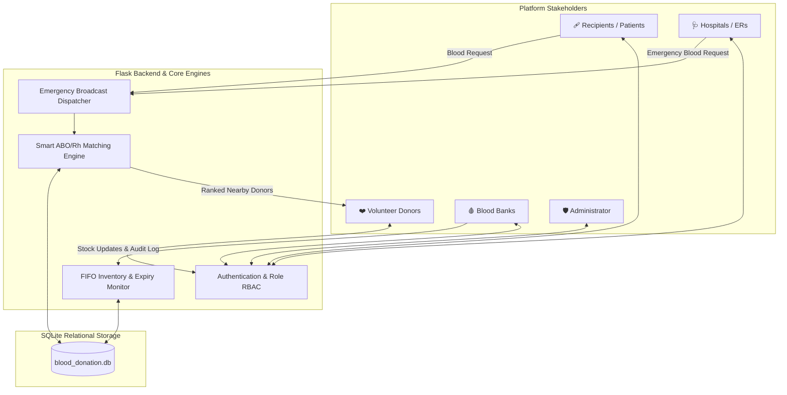

# Smart Blood Donation Management System 🩸
**A Centralized Digital Platform Connecting Donors, Recipients, Hospitals, and Blood Banks**  
*College Project-Based Learning (PBL) Demonstration Prototype*

---

## 📌 Project Overview
The **Smart Blood Donation Management System** is a complete, modular, and functional web application prototype engineered to overcome critical bottlenecks in emergency blood logistics. It synchronizes volunteer donors, recipient families, emergency hospital departments, and certified blood banks into a cohesive ecosystem featuring:

1. **Smart Algorithmic Matching**: Multi-factor ranking based on ABO/Rh red-cell compatibility, geographic proximity (Haversine formula), donor availability, and post-donation recovery intervals.
2. **Emergency Blood Request Broadcasts**: Automated tracking workflow (`Submitted` ➔ `Matching in Progress` ➔ `Donors Notified` ➔ `Response Received` ➔ `Fulfilled`), with real-time in-app match alerts.
3. **Blood Bank FIFO Inventory Management**: Batch tracking with automated expiry alerts, minimum reserve thresholds, and negative-stock prevention.
4. **Self-Service Donor Appointments**: Booking, scheduling, and tracking donation slots at participating centers.
5. **5 Role-Tailored Dashboards**: Dedicated interfaces for Donors, Recipients, Hospitals, Blood Banks, and System Administrators.

---

## 🛠️ Technology Stack
* **Backend:** Python 3 (Flask 3.x, Werkzeug secure password hashing, SQLite3 integration)
* **Database:** SQLite with foreign keys, indexes, and audit logging (`blood_donation.db`)
* **Frontend:** Vanilla HTML5, Modern Healthcare CSS3 Design System (Glassmorphism, micro-animations, responsive grid), JavaScript (ES6)
* **Icons & Visuals:** Font Awesome 6.5
* **Analytics & Dashboards:** Chart.js

---

## 🏗️ System Architecture & Workflow



---

## 🔑 Demonstration Accounts (PBL Credentials Table)

All accounts are pre-seeded with fictional test data. You can log in using the credentials below or click the **1-Click Demo Buttons** on the `/login` screen.

| Role | Name / Facility | Email | Password | Details / Permissions |
| :--- | :--- | :--- | :--- | :--- |
| **Administrator** | Dr. Evelyn Reed | `admin@bloodcare.org` | `admin123` | System telemetry, Chart.js KPIs, user account controls, database reseeding |
| **Blood Bank** | Central Red Cross Center | `central.bank@metroblood.org` | `bank123` | Inventory CRUD, batch expiry tracking, collection/issue transactions, appointments |
| **Blood Bank** | City LifeLine Blood Services | `city.lifeline@bloodbank.org` | `bank123` | Storage facility in Downtown area |
| **Hospital (ER)** | St. Mary Memorial Hospital | `stmary.er@hospital.org` | `hospital123` | Trauma requests, donor matching monitor, blood reserve tracking |
| **Hospital (ER)** | Metropolitan General | `metropolitan.er@hospital.org` | `hospital123` | Level 1 Trauma center request management |
| **NGO Foundation** | Hope & Life Blood Awareness | `hope.life@ngo.org` | `ngo123` | Community blood drives, awareness camps, and trauma assistance |
| **Donor (O-)** | Alex Rivera | `alex.donor@example.com` | `donor123` | **Universal Red-Cell Donor**, availability toggle, match invitations |
| **Donor (A+)** | Priya Patel | `priya.patel@example.com` | `donor123` | Regular donor with accepted response records |
| **Donor (B+)** | Marcus Chen | `marcus.chen@example.com` | `donor123` | Active donor in Westside district |
| **Donor (AB+)** | Elena Rostova | `elena.rostova@example.com` | `donor123` | **Universal Recipient**, plasma donor candidate |
| **Donor (O+)** | James Wilson | `james.wilson@example.com` | `donor123` | Donor currently in recovery interval cooldown |
| **Recipient** | Sarah Jenkins | `sarah.jenkins@example.com` | `recipient123` | Request tracking, active donor contacts, orthopedic surgery patient |
| **Recipient** | David Miller | `david.miller@example.com` | `recipient123` | Family member therapy transfusion requests |

---

## 🔬 Smart Donor Matching Logic

The matching algorithm ranks eligible donors according to five transparent clinical and logistical rules:

1. **Red-Cell Biological Compatibility**: Evaluates ABO and Rh compatibility:
   - **O-**: Universal red-cell donor (can donate to all 8 blood groups).
   - **AB+**: Universal red-cell recipient (can receive from all 8 blood groups).
   - Exact ABO/Rh matches receive a priority scoring weight (+50 pts) over compatible non-exact groups (+35 pts).
2. **Proximity & Distance**: Uses the spherical Haversine formula to rank donors closest to the requested hospital.
3. **Availability State**: Donors actively marked "Available" are prioritized.
4. **Donation Recovery Interval**: Evaluates the minimum 90-day cooldown period between whole-blood donations.
5. **Contact Clearance**: Exposes personal contact details only when a donor explicitly accepts an in-app invitation or gives consent.

> **⚠️ Academic & Clinical Safety Notice:** This application is an educational prototype. The matching algorithm identifies candidates for medical review and does NOT replace laboratory serological cross-matching, infectious disease screening, or certified clinical approval.

---

## 🚀 Installation & Running Locally

### 1. Clone or Navigate to Directory
```bash
cd Smart-Blood-Donation-System
```

### 2. Install Dependencies
```bash
pip install -r requirements.txt
```

### 3. Initialize & Seed Database
```bash
python3 database.py
```

### 4. Start the Application
```bash
python3 app.py
```

Open your browser and visit: **`http://127.0.0.1:5000`**

---

## 🧪 Running Automated Unit Tests
To run the automated verification suite covering matching rules, role logins, request workflows, and inventory checks:

```bash
python3 test_app.py
```

---

## 📂 Project Structure
```
Smart-Blood-Donation-System/
├── app.py                     # Main Flask application, routes, role RBAC decorators & APIs
├── database.py                # Database connection helpers & seed data generator
├── matching.py                # Smart compatibility matching engine & distance calculator
├── schema.sql                 # SQLite schema with foreign keys and indexes
├── test_app.py                # Automated unit tests for all workflows
├── requirements.txt           # Python dependencies
├── README.md                  # System documentation & demo credentials
├── static/
│   ├── css/
│   │   └── style.css          # Healthcare UI design system, glassmorphism, responsive grid
│   └── js/
│       ├── main.js            # Modals, mobile menu, demo autofill & compatibility widget
│       └── dashboard.js       # Chart.js analytics & live search filters
└── templates/
    ├── base.html              # Layout template with notifications bell & responsive navbar
    ├── index.html             # Landing page with stats, interactive matrix, urgent ticker
    ├── about.html             # Project PBL overview & safety disclaimer
    ├── blood_banks.html       # Public directory of blood banks & live inventory summary
    ├── find_blood.html        # Smart blood finder & donor matching tool
    ├── emergency_request.html # High-priority emergency broadcast submission
    ├── request_detail.html    # 5-step status timeline tracking & matched donors
    ├── auth/
    │   ├── login.html         # Unified login with 1-click demo account selector
    │   └── register.html      # Dynamic role-based registration
    └── dashboards/
        ├── donor_dashboard.html      # Donor portal, availability toggle, appointments
        ├── recipient_dashboard.html  # Recipient portal & request creator
        ├── hospital_dashboard.html   # Hospital ER emergency request monitor
        ├── bloodbank_dashboard.html  # Blood Bank inventory CRUD & transaction logger
        └── admin_dashboard.html      # Admin dashboard with Chart.js analytics & user audit
```